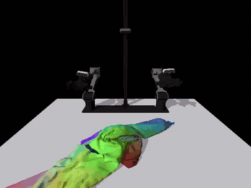

# ClothDojo

### Learned Data Generation and Benchmarking for Bimanual Garment Flattening and Folding

Zilong Huang, Zipeng Ye, Caicheng Wang, Yuchen Xie, Jiaxiang Luo

[Website](https://clothdojo.github.io/) · [Paper](https://arxiv.org/abs/2611.01190) · [Assets](https://huggingface.co/datasets/clothdojo/assets)

ClothDojo generates bimanual garment-manipulation trajectories in simulation, with NOCS teachers for flattening and folding.

| cam_high | cam_low |
| :---: | :---: |
| [](docs/assets/nocs-flatten.mp4) | [](docs/assets/nocs-flatten-low.mp4) |

## Getting started

Follow the [Quickstart](docs/usage.md): install the environment, generate a trajectory with `clothdojo generate`, then export high and low camera videos with `clothdojo replay`.

The NOCS workflow runs on one NVIDIA GPU and does not require Isaac Sim. The guide includes requirements, folding, and options for paths, GPU and generation size.

## Resources

- [Assets](https://huggingface.co/datasets/clothdojo/assets) · [NOCS teachers](https://huggingface.co/clothdojo/nocs-teachers) · [Download details](docs/data-and-assets.md)
- [More workflows](docs/advanced.md): successful-trajectory selection, evaluation, and RGB export
- [Questions and bug reports](https://github.com/clothdojo/clothdojo.github.io/issues)

## Citation

If you use ClothDojo in your research, please cite:

```bibtex
@misc{huang2026clothdojo,
  title = {{ClothDojo}: Learned Data Generation and Benchmarking for Bimanual Garment Flattening and Folding},
  author = {Huang, Zilong and Ye, Zipeng and Wang, Caicheng and Xie, Yuchen and Luo, Jiaxiang},
  year = {2026},
  eprint = {2611.01190},
  archivePrefix = {arXiv},
  primaryClass = {cs.RO},
  url = {https://arxiv.org/abs/2611.01190}
}
```

## License

The code is released under [Apache-2.0](LICENSE). Downloaded data, weights, and third-party assets retain their respective licenses; see [attribution and third-party notices](THIRD_PARTY_NOTICES.md).
