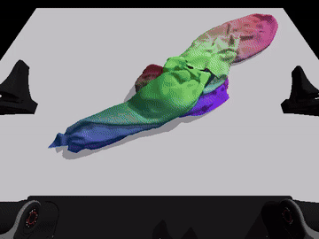

# ClothDojo

### Learned Data Generation and Benchmarking for Bimanual Garment Flattening and Folding

Zilong Huang, Zipeng Ye, Caicheng Wang, Yuchen Xie, Jiaxiang Luo

[Website](https://clothdojo.github.io/) · [Paper](https://arxiv.org/abs/2611.01190) · [Assets](https://huggingface.co/datasets/clothdojo/assets)

ClothDojo generates bimanual garment-manipulation trajectories in simulation, with NOCS teachers for flattening and folding.

[](docs/assets/nocs-flatten.mp4)

Quickstart example · 4× preview · [Full 60-second replay](docs/assets/nocs-flatten.mp4)

## Getting started

Use Linux x86_64, Python 3.11, Git, `patch`, [uv](https://docs.astral.sh/uv/), and an NVIDIA GPU with native BF16 support. We tested this on one RTX 5090 D v2 (24 GB). Isaac Sim is not required for NOCS generation.

```bash
git clone https://github.com/clothdojo/clothdojo.github.io.git ClothDojo
cd ClothDojo
```

Then download the assets and flattening teacher, install the environment, and run:

```bash
bash scripts/download.sh flatten
bash scripts/setup.sh
bash scripts/quickstart.sh flatten
```

The script generates one trajectory, exports high and low camera views, and prints the MP4 paths. See the [Quickstart](docs/usage.md) for prerequisites and the folding example. All source code comes from this GitHub checkout; Hugging Face supplies assets and weights.

The output contains robot actions, robot/cloth states, metadata, and both replay videos.

## Using ClothDojo

After activating `.venv`, run `clothdojo generate` and copy its printed `clothdojo replay` command for both camera views. Add options only when needed, such as `--task fold`, `--gpu 1`, or `--output outputs/my-run`.

The [step-by-step Quickstart](docs/usage.md#3-run-the-steps-yourself) explains the options and how to generate trajectories and watch both camera views.

## Resources

- [Assets](https://huggingface.co/datasets/clothdojo/assets) · [NOCS teachers](https://huggingface.co/clothdojo/nocs-teachers) · [Download details](docs/data-and-assets.md)
- [More workflows](docs/advanced.md): folding, successful-trajectory selection, evaluation, and RGB export
- [Questions and bug reports](https://github.com/clothdojo/clothdojo.github.io/issues)

## Citation

If you use ClothDojo in your research, please cite:

```bibtex
@misc{huang2026clothdojo,
  title = {{ClothDojo}: Learned Data Generation and Benchmarking for Bimanual Garment Flattening and Folding},
  author = {Huang, Zilong and Ye, Zipeng and Wang, Caicheng and Xie, Yuchen and Luo, Jiaxiang},
  year = {2026},
  eprint = {2611.01190},
  archivePrefix = {arXiv},
  primaryClass = {cs.RO},
  url = {https://arxiv.org/abs/2611.01190}
}
```

## License

The code is released under [Apache-2.0](LICENSE). Downloaded data, weights, and third-party assets retain their respective licenses; see [attribution and third-party notices](THIRD_PARTY_NOTICES.md).
