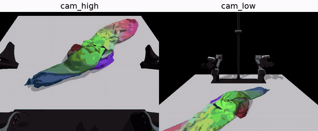
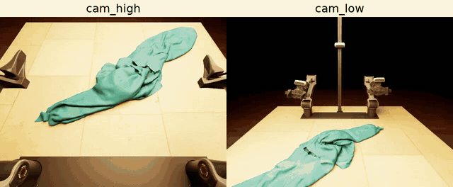

# ClothDojo

### Learned Data Generation and Benchmarking for Bimanual Garment Flattening and Folding

Zilong Huang, Zipeng Ye, Caicheng Wang, Yuchen Xie, Jiaxiang Luo

[Website](https://clothdojo.github.io/) · [Paper](https://arxiv.org/abs/2611.01190) · [Assets](https://huggingface.co/datasets/clothdojo/assets)

ClothDojo generates bimanual garment-manipulation trajectories in simulation, with NOCS teachers for flattening and folding.

## NOCS Quickstart

Follow the [Quickstart](docs/usage.md) to generate a trajectory and watch its high and low camera videos on one NVIDIA GPU. Isaac Sim is not required.

[](docs/assets/nocs-flatten-paired.mp4)

## Randomized RGB rendering

Follow the [RGB rendering guide](docs/randomized-rendering.md) to render the saved motion with different materials and lighting. Add Isaac Sim 5 to the same environment with `setup.sh --rgb`; rendering requires an RTX GPU.

[](docs/assets/randomized-rgb-paired.mp4)

## RGB policy training and evaluation

Follow the [RGB policy guide](docs/rgb-policy.md) to download Flatten demonstrations,
train an example policy, and evaluate it on repaired initial states.
To evaluate an existing checkpoint or connect another model, see [model adapters](docs/model-adapters.md).

## Citation

If you use ClothDojo in your research, please cite:

```bibtex
@misc{huang2026clothdojo,
  title = {{ClothDojo}: Learned Data Generation and Benchmarking for Bimanual Garment Flattening and Folding},
  author = {Huang, Zilong and Ye, Zipeng and Wang, Caicheng and Xie, Yuchen and Luo, Jiaxiang},
  year = {2026},
  eprint = {2611.01190},
  archivePrefix = {arXiv},
  primaryClass = {cs.RO},
  url = {https://arxiv.org/abs/2611.01190}
}
```

## License

The code is released under [Apache-2.0](LICENSE). Downloaded data, weights, and third-party assets retain their respective licenses; see [attribution and third-party notices](THIRD_PARTY_NOTICES.md).
