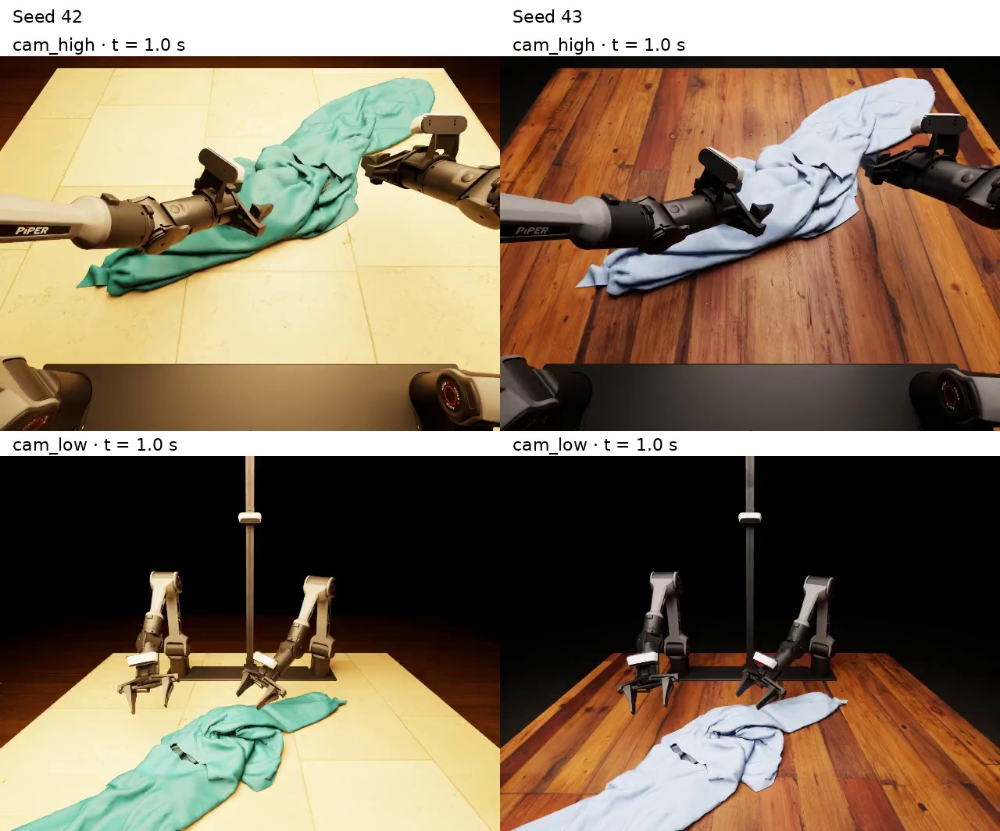

# Randomized RGB rendering

Reuse the trajectory from the [Quickstart](usage.md) with different materials and lighting. The recorded motion stays the same; Isaac RTX replaces the NOCS appearance with RGB rendering.

## 1. Prepare the renderer

Use an RTX GPU with RT cores and Vulkan support. Complete the [Isaac 5 runtime installation](upstream-dependencies.md#isaac-5-runtime) in the existing Python 3.11 environment, then activate it:

```bash
source .venv/bin/activate
```

Download the public Poly Haven material set from Hugging Face:

```bash
uvx --from 'huggingface-hub==0.32.3' huggingface-cli download clothdojo/assets \
  --repo-type dataset --revision a0628f42dde13ebb0505fd9dc255d4bda50edb94 \
  --include 'data/visual-assets/polyhaven/*' --local-dir .
```

This example randomizes cloth, table and ground materials and lighting, with a fixed background. It does not require the excluded NVIDIA scene assets. Run all commands from the checkout root.

## 2. Render the saved trajectory

```bash
clothdojo data export-lerobot \
  --source outputs/first-flatten/rollout \
  --output outputs/rgb-seed42 \
  --assets benchmark/assets \
  --isaac-seed 42 --randomize all
```

The command uses GPU 0 by default and exports RGB videos plus LeRobot v2.1 data. It does not restart the teacher or simulate new actions. The first run also builds the RTX rendering stage and shaders, which can take several minutes.

## 3. Watch the RGB videos

Open these files in your video player:

```text
outputs/rgb-seed42/videos/chunk-000/
  observation.images.cam_high/episode_000000.mp4
  observation.images.cam_low/episode_000000.mp4
```

The two wrist-camera videos are exported alongside them. The full flattening trajectory remains 60 seconds; RGB export uses the recorded control rate of 50 fps.

The same recorded pose at one second, rendered with two seeds:



## Try another appearance

Run the render command again with `--isaac-seed 43` and `--output outputs/rgb-seed43`. Compare the same camera and timestamp: the actions are unchanged, while the sampled appearance differs. A layout stays fixed throughout each trajectory; the same trajectory and seed select the same layout.

Change only what you need:

| Option | Purpose |
|---|---|
| `--isaac-seed` | Select another appearance |
| `--randomize cloth,lighting` | Choose which components vary between trajectories in one export; also accepts `table` and `ground` |
| `--device cuda:1` | Render on another visible GPU |
| `--visual-assets /path/to/visual-assets` | Use visual resources stored elsewhere |

Use a new output directory for each export. This example visualizes an unfiltered trajectory; use [success-selected trajectories](advanced.md#generate-successful-trajectories) before preparing training data. For the full appearance profiles and their upstream backgrounds/materials, see the [NVIDIA asset guide](upstream-dependencies.md#nvidia-visual-assets-for-rgb).
