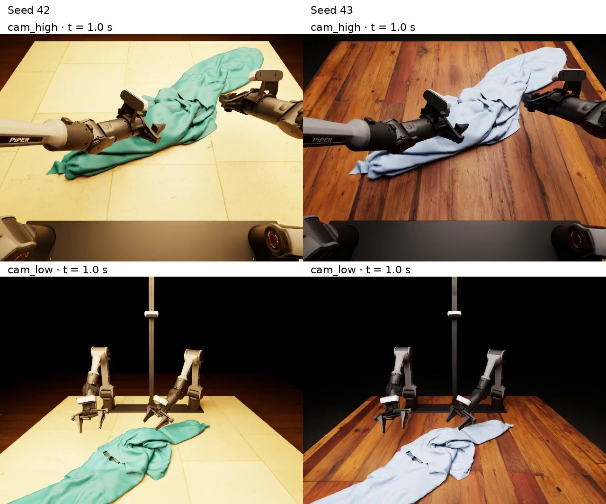

# Quickstart

Install ClothDojo, generate a trajectory, watch its NOCS videos, then render the same motion as randomized RGB videos. Follow the steps in order in one terminal.

You need Linux x86_64, Python 3.11, Git, `patch`, [uv](https://docs.astral.sh/uv/), and an NVIDIA GPU with native BF16 support. Tested on one RTX 5090 D v2 (24 GB).

For the RGB steps, the GPU must also support RTX ray tracing and Vulkan, and Linux needs GLIBC 2.35 or newer. Isaac Sim is installed only in step 4.

The first download is about 13.4 GiB, plus space for the environment, caches and later RGB resources.

## 1. Download and install

```bash
git clone https://github.com/clothdojo/clothdojo.github.io.git ClothDojo
cd ClothDojo
bash scripts/download.sh flatten
bash scripts/setup.sh
source .venv/bin/activate
```

`download.sh` fetches assets and the selected teacher from Hugging Face. `setup.sh` creates `.venv/` and installs the library and its dependencies. Run the remaining commands from this checkout root.

## 2. Generate a trajectory

```bash
clothdojo generate --output outputs/first-flatten
```

This starts the flattening teacher on GPU 0, simulates one 60-second trajectory, saves it, and stops the teacher. The first run downloads the upstream tokenizer and compiles CUDA kernels, so it takes longer.

The trajectory collection is saved in `outputs/first-flatten/rollout/`; logs are in `outputs/first-flatten/logs/`. This is an unfiltered example, not a success-selected training trajectory.

## 3. Watch both NOCS views

```bash
clothdojo replay outputs/first-flatten/rollout
```

Open the two MP4 paths printed by the command in your video player:

```text
outputs/first-flatten/rollout/
  review/videos/cam_high/<trajectory-id>.mp4
  review-low/videos/cam_low/<trajectory-id>.mp4
```

Each NOCS video is 60 seconds at 640×480 and 10 fps.

## 4. Prepare RGB rendering

In the same activated environment, install the pinned Isaac Sim 5.0 runtime:

```bash
python -m pip install --extra-index-url https://pypi.nvidia.com --no-deps \
  'isaacsim==5.0.0' 'isaacsim-app==5.0.0' 'isaacsim-core==5.0.0' \
  'isaacsim-replicator==5.0.0' 'isaacsim-extscache-kit==5.0.0' \
  'isaacsim-extscache-kit-sdk==5.0.0' 'isaacsim-extscache-physics==5.0.0' \
  'isaacsim-kernel==5.0.0' 'omniverse-kit==107.3.1.206797'
```

Keep `--no-deps` to preserve the shared Python dependency versions. Download the public Poly Haven materials:

```bash
uvx --from 'huggingface-hub==0.32.3' huggingface-cli download clothdojo/assets \
  --repo-type dataset --revision a0628f42dde13ebb0505fd9dc255d4bda50edb94 \
  --include 'data/visual-assets/polyhaven/*' --local-dir .
```

This example varies cloth, table and ground materials and lighting, with a fixed background. No additional NVIDIA scene assets are needed.

## 5. Render and watch RGB videos

```bash
clothdojo data export-lerobot \
  --source outputs/first-flatten/rollout \
  --output outputs/rgb-seed42 \
  --assets benchmark/assets \
  --isaac-seed 42 --randomize all
```

This renders the saved motion from step 2 on GPU 0. The first RTX stage and shader setup can take several minutes.

Open the resulting MP4s:

```text
outputs/rgb-seed42/videos/chunk-000/
  observation.images.cam_high/episode_000000.mp4
  observation.images.cam_low/episode_000000.mp4
```

The videos remain 60 seconds long, now at the recorded control rate of 50 fps. Two wrist-camera videos and accompanying LeRobot v2.1 data are also exported.

To compare another appearance, rerun the command with `--isaac-seed 43` and `--output outputs/rgb-seed43`. The same recorded pose rendered with the two seeds looks like this:



## Try folding

Use the installed environment:

```bash
bash scripts/download.sh fold
clothdojo generate --task fold --output outputs/first-fold
clothdojo replay outputs/first-fold/rollout
```

This produces a 40-second folding trajectory and its NOCS videos. For RGB, use `outputs/first-fold/rollout` as `--source` in step 5 and choose a new output directory.

## Change a run

Defaults use GPU 0, `benchmark/`, and `models/nocs-teachers/`. Change these only when needed with `--gpu`, `--benchmark`, or `--teachers`. For RGB export, GPU selection is `--device cuda:1` and resource paths are `--assets` and `--visual-assets`.

Paths are relative to the checkout root; absolute paths and `~` are also supported. Keep the downloaded folder layouts intact so task-matched states, weights and normalization can be selected automatically.

For eight trajectories:

```bash
clothdojo generate --seen-assets 2 --unseen-assets 2 --states-per-asset 2
```

Selection follows the recorded pool order, not random sampling. The released pool has four initial states per garment; generation uses one simulation world at a time.

Use a new output directory for each generation or RGB export. Omit `--output` on `generate` for an automatic run directory; its printed replay command carries the matching path and GPU. Replaying an existing collection reuses matching NOCS videos.

Use `clothdojo generate --help`, `clothdojo replay --help`, or `clothdojo data export-lerobot --help` for all options. Continue to the [RGB reference](randomized-rendering.md) for appearance controls, or [more workflows](advanced.md) for success selection, evaluation and training-data export.
